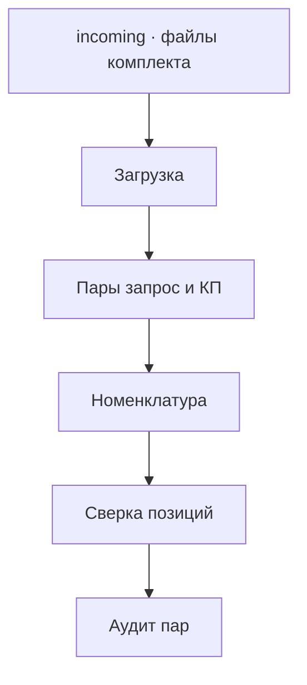
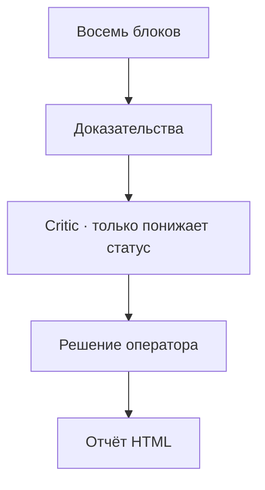

# kp-tz-check

Проверка закупочного комплекта **запрос → коммерческое предложение → техническое задание** перед передачей на согласование. Правила считает детерминированный код. Недостающие данные остаются «требует уточнения» или «не проверен». LLM может только предложить структуру и связи и не повышает статусы.

Схема и список функций: [docs/system.md](docs/system.md). Журнал спринтов: [docs/tz-implementation-plan.md](docs/tz-implementation-plan.md).

Правила и методички:

- `docs/Промт Проверка запросов, ТЗ, КП.docx`
- `docs/Инструкция.docx` — в КП нужны конкретные показатели, единица измерения берётся из ТЗ
- `docs/laws/Положение 223-ФЗ от 27.03.2026 г..docx` — анализ рынка, не менее 3 ценовых предложений
- `docs/laws/223-ФЗ.docx` — Федеральный закон № 223-ФЗ

## Как проходит проверка

1. Файлы кладутся в подпапки `incoming/` по типу документа.
2. Страница **Проверка** читает комплект и запускает граф.
3. Страница **Результаты** показывает восемь блоков, пары «запрос — КП» и итог.
4. **Поставщики**, **Расчёты**, **ОКПД2**, **Календарь** и **Обеспечение** показывают детали того же прогона.
5. **Процедура** считает минимальные сроки закупки отдельно от хронологии комплекта.
6. **Решения** фиксирует выбор оператора. Статус пары можно только понизить.
7. **Запрос** собирает черновик письма. Письмо не отправляется.
8. **Диагностика** и **Настройки** лежат в разделе «Служебные». Диагностика сверяет регрессию и не входит в функции ТЗ.
9. **README** и **Схема работы** лежат в разделе «Статус проекта» и показывают эти документы.

<!-- kp-columns -->
**Шаги 1–6**



**Шаги 7–11**


<!-- /kp-columns -->

Critic смотрит серую зону и может только понизить статус пары. Поиск характеристик, форма ЕГРЮЛ и живые реестры в эту цепочку не входят.

## Что уже считается

Восемь блоков заключения:

| Блок | Содержание |
|---|---|
| 1. Комплектность и хронология | на каждый запрос есть КП, нет КП без запроса; дата отправки ≤ дата подготовки КП ≤ дата регистрации |
| 2. Сверка позиций | наименование, характеристики, единица, количество; одинаковые названия различаются по характеристикам |
| 3. Национальный режим и конкуренция | по локальному перечню; без файла перечень остаётся «не проверен» |
| 4. Расчёт НМЦК | среднее сопоставимых цен КП, CV с делением на n; два независимых расчёта |
| 5. Арифметика заявки | сумма строк и итог, явно подписанный в тексте |
| 6. ОКПД2 и СМП | по локальному справочнику; без файла — «не проверен» |
| 7. НПА и стандарты | актуальность ссылок по локальной базе |
| 8. Обеспечение | заявка и исполнение договора по найденным суммам |

Итог комплекта:

- **Можно передавать далее без изменений** — все восемь блоков проверены и без замечаний
- **Требуется доработка** — есть замечания или непроверенные блоки
- **Требуется решение закупочной комиссии** — есть критичная ошибка

Статусы пары «запрос — КП»: **Соответствует**, **Требует уточнения**, **Не соответствует**.

Отдельно от восьми блоков, по явному действию оператора:

- карточка поставщика и открытая форма ЕГРЮЛ, если включён `KP_REGISTRY_EGRUL`;
- отклонение цены КП от НМЦК: −25 %, +20 % и выброс дальше 2σ; колонка рыночной цены пустая, пока нет подтверждённой внешней цены;
- заявка участника по частям, протоколы, отчёт о соответствии в HTML;
- поиск характеристик по списку хостов, если включён `KP_CHARACTERISTIC_SEARCH`; найденная строка остаётся кандидатом до подтверждения;
- черновик договора после подтверждения и черновик запроса КП.

## Входные данные

Поддерживаются `.docx`, `.doc` и `.pdf`. Тип документа задаёт папка, а не содержимое.

| Папка | Что класть |
|---|---|
| `incoming/requests` | запросы поставщикам; дата отправки в тексте, например `Исх №2738 от 27.08.2026` |
| `incoming/kp` | коммерческие предложения; дата регистрации в имени файла, дата подготовки внутри документа |
| `incoming/tz` | техническое задание, эталон номенклатуры |
| `incoming/applications` | заявки участников |
| `incoming/bids/<участник>/` | части заявки |
| `incoming/protocols` | протоколы |
| `incoming/nmck` | файл обоснования НМЦК |
| `incoming/security` | документы обеспечения |

Один файл запроса может содержать несколько исходящих писем. Каждое письмо проверяется отдельно. Справочники в `data/` — примеры формата. Нет боевого файла — проверка ставит «не проверен» и не подставляет значения.

## Запуск

macOS и Linux:

```bash
.venv/bin/python -m pip install -r requirements.txt
PYTHONPATH=src .venv/bin/python -m streamlit run app.py
```

Windows:

```powershell
py -3.11 -m venv .venv
.\.venv\Scripts\python.exe -m pip install -r requirements.txt
$env:PYTHONPATH = "src"
.\.venv\Scripts\python.exe -m streamlit run app.py
```

CLI без графа пишет текстовую сводку пар и HTML. С `--graph` проходит цепочку целиком.

macOS и Linux:

```bash
PYTHONPATH=src .venv/bin/python -m kp_tz_check --incoming incoming --out reports/report.html
PYTHONPATH=src .venv/bin/python -m kp_tz_check --graph --incoming incoming --out reports/report.html
PYTHONPATH=src .venv/bin/python -m pytest -q
```

Windows:

```powershell
$env:PYTHONPATH = "src"
.\.venv\Scripts\python.exe -m kp_tz_check --incoming incoming --out reports/report.html
.\.venv\Scripts\python.exe -m kp_tz_check --graph --incoming incoming --out reports/report.html
.\.venv\Scripts\python.exe -m pytest -q
```

### Опциональный private LLM

По умолчанию граф работает без LLM. Для локальной модели через Unsloth Studio или другой OpenAI-compatible сервер:

macOS и Linux:

```bash
cp .env.example .env
# UNSLOTH_API_KEY=sk-unsloth-...
PYTHONPATH=src .venv/bin/python -m kp_tz_check --graph
```

Windows:

```powershell
Copy-Item .env.example .env
# UNSLOTH_API_KEY=sk-unsloth-...
$env:PYTHONPATH = "src"
.\.venv\Scripts\python.exe -m kp_tz_check --graph
```

`UNSLOTH_API_KEY`, `TOGETHER_API_KEY` и другие ключи читаются из `.env` и не показываются в интерфейсе. Модели задаются через `UNSLOTH_MODEL`, `OLLAMA_MODEL` или `TOGETHER_MODEL`. `KP_LLM_BASE_URL` указывается без `/v1`. Если endpoint недоступен, запуск с LLM завершается ошибкой. Обычный режим без `KP_LLM_ENABLED=true` остаётся детерминированным.

Проверка endpoint без документов:

```bash
PYTHONPATH=src .venv/bin/python -m kp_tz_check.llm_smoke
```

```powershell
$env:PYTHONPATH = "src"
.\.venv\Scripts\python.exe -m kp_tz_check.llm_smoke
```

### Диагностика

Регрессия сравнивает прямой аудит и проход графа по отпечаткам пар:

```bash
PYTHONPATH=src .venv/bin/python -m kp_tz_check.eval --incoming incoming
```

```powershell
$env:PYTHONPATH = "src"
.\.venv\Scripts\python.exe -m kp_tz_check.eval --incoming incoming
```

Страница в интерфейсе называется **Диагностика**. Адрес страницы остаётся `/Eval`.

### Флаги внешних источников

Все выключены по умолчанию. Обычный прогон сеть не вызывает.

| Флаг | Поведение |
|---|---|
| `KP_REGISTRY_EGRUL` | открытая форма `egrul.nalog.ru` по ИНН или ОГРН; при запросе подтверждения формой поиск останавливается |
| `KP_REGISTRY_RNP`, `KP_REGISTRY_ECG`, `KP_REGISTRY_MARKET` | без подставленного клиента проверка останавливается и сеть не вызывает |
| `KP_CHARACTERISTIC_SEARCH` | запросы только к хостам allowlist |

## Что остаётся на отдельное решение

Разделы 5–8 ТЗ, права доступа, единое хранилище, автообновление базы знаний, живые РНП, ЭКГ, ЕИС, маркетплейсы и общий поисковик, выгрузки отчёта в PDF, DOCX и XLSX, электронная подпись, отправка писем и уведомления сотрудникам.
