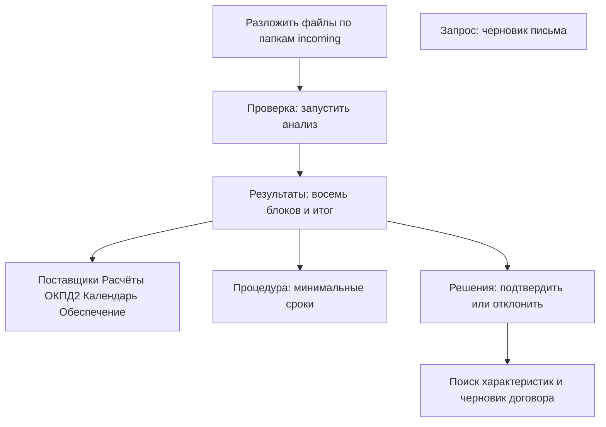
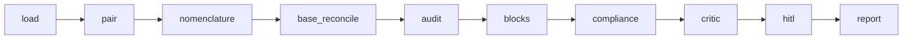

# Как устроена проверка

Документ описывает то, что считает текущий код. Журнал спринтов — в [tz-implementation-plan.md](tz-implementation-plan.md).

Источник истины — детерминированные правила. Непрочитанное поле остаётся «требует уточнения» или «не проверен». Статус пары «запрос — КП» можно только понизить. LLM, если он включён, предлагает структуру и связи и не меняет расчёты, даты и статусы.

## Последовательность для оператора

1. Документы раскладываются по типу. Папка задаёт вид документа.
2. **Проверка** вызывает граф и сохраняет результат в сессии. Следующие страницы читают этот результат.
3. **Результаты** показывают сводное заключение, пары и доказательства compliance.
4. Детальные страницы не запускают новый прогон.
5. **Календарь** показывает хронологию комплекта: отправка запроса, подготовка КП, регистрация КП. **Процедура** считает минимальные сроки закупки и с календарём комплекта не смешивается.
6. **Решения** принимает строки «Требует уточнения», подтверждает заключение и по отдельной команде запускает поиск характеристик или сборку договора.
7. **Запрос** собирает черновик из примера `data/requests/kp-request.example.docx`. Почта не отправляется.
8. **Диагностика** сравнивает прямой аудит и граф. **Настройки** показывают флаги и провайдеров. Обе страницы в разделе «Служебные».
9. **README** и **Схема работы** в разделе «Статус проекта» показывают этот документ и README.

## Последовательность графа

Один прогон `run_pack` в [src/kp_tz_check/graph.py](../src/kp_tz_check/graph.py):

| Шаг | Что делает |
|---|---|
| load | читает `incoming/requests`, `incoming/kp`, `incoming/tz`, `incoming/applications` |
| pair | связывает исходящий запрос и КП |
| nomenclature | сопоставляет позиции ТЗ и КП |
| base_reconcile | сводит позиции закупки в единую таблицу и не пересчитывает статусы пар |
| audit | ставит статус пары: хронология, номенклатура, полнота пакета |
| blocks | собирает восемь блоков из уже посчитанных проверок |
| compliance | оставляет доказательства по правилам, которые сработали |
| critic | в серой зоне может только понизить статус пары |
| hitl | применяет уже записанное решение оператора |
| report | пишет текст и `reports/report.html` |

Поиск характеристик, форма ЕГРЮЛ, живые реестры и конструктор запроса узлами графа не являются. `load_incoming` по-прежнему возвращает четыре списка: запросы, КП, ТЗ, заявки. Заявки по частям и протоколы читаются отдельными функциями.

## Реализованные функции

### Комплект и пары

- Разбор `.docx`, `.doc` и текстового слоя `.pdf`. Несколько исходящих писем в одном файле запроса разбираются по отдельности.
- Хронология: дата отправки запроса ≤ дата подготовки КП ≤ дата регистрации КП. Дата, которую нельзя прочитать, не выдумывается.
- Номенклатура: наличие позиций ТЗ в КП, лишние строки КП, наименование, характеристики, единица, количество. Одинаковые названия различаются по характеристикам.
- Полнота пакета: КП на каждый запрос и отсутствие КП без запроса.

Статусы пары: «Соответствует», «Требует уточнения», «Не соответствует».

### Восемь блоков заключения

Модуль [src/kp_tz_check/blocks.py](../src/kp_tz_check/blocks.py). Статусы блока: «Проверен, замечаний нет», «Проверен, есть замечания», «Проверен, критичные ошибки», «Не проверен — документы не предоставлены».

| Блок | Функция | Модуль |
|---|---|---|
| 1. Комплектность пакета и хронология | полнота пар и порядок дат | `checks.py`, `timeline.py` |
| 2. Сверка позиций закупки | единая таблица позиций | `base_reconcile.py` |
| 3. Национальный режим и конкуренция | локальный перечень; без файла — «не проверен» | `competition.py` |
| 4. Расчёт НМЦК | среднее сопоставимых цен, CV, сверка с файлом обоснования | `calculations.py`, `nmck.py` |
| 5. Арифметическая проверка заявки | количество × цена и итог документа | `calculations.py`, `application_math.py` |
| 6. Коды ОКПД2 и статус СМП | локальный справочник; без файла — «не проверен» | `okpd2.py` |
| 7. Актуальность НПА и стандартов | локальная база ссылок | `npa.py` |
| 8. Обеспечение заявки и исполнения контракта | суммы и пороги по найденным документам | `security.py` |

Итог в [src/kp_tz_check/conclusion.py](../src/kp_tz_check/conclusion.py):

- критичная ошибка любого блока — «Требуется решение закупочной комиссии»;
- непроверенный блок или замечание — «Требуется доработка»;
- все восемь блоков без замечаний — «Можно передавать далее без изменений».

У каждого пункта на уточнение есть ответственный: инициатор заявки, ответственный за ТЗ или поставщик.

Среднее и коэффициент вариации считаются дважды независимыми функциями. Совпали — в отчёте одна пара чисел. Расхождение — «требует ручной проверки» и оба результата. Делитель CV — n, стандартное отклонение совокупности.

Для НМЦК по позиции нужны не меньше трёх цен разных поставщиков, одна единица измерения и один режим НДС. Иначе позиция остаётся «недостаточно данных». Отклонение цены КП от НМЦК: −25 % и ниже — риск демпинга, +20 % и выше — цена выше порога, дальше 2σ от среднего КП — аномалия. Надпись «Цены обоснованы» появляется только вместе с внешней рыночной ценой и пройденным CV. Внешняя цена в обычном прогоне пустая.

### После прогона, по действию оператора

- **Поставщики.** Реквизиты из документов последней проверки. Конфликт названия запроса и КП даёт «Выявлены риски». Десять критериев легитимности без живого реестра остаются «не проверен». Карточка не получает статус «Все поставщики легитимны».
- **ЕГРЮЛ.** При `KP_REGISTRY_EGRUL` страница «Поставщики» читает открытую форму `https://egrul.nalog.ru/` по ИНН или ОГРН. Несколько точных совпадений дают «требует уточнения». Если форма просит подтверждение, поиск останавливается. Запрос по названию не отправляется.
- **Заявка участника.** `incoming/applications` и пакет `incoming/bids/<участник>/`. Текстовый слой без OCR. Пока реестры выключены, статус «Допущен к аукциону» недостижим.
- **Протоколы.** `incoming/protocols`, правила протокола без формирования письма.
- **Соответствие и риски.** Отчёт в HTML на странице «Решения». Выгрузки PDF, DOCX и XLSX нет.
- **Поиск характеристик.** Флаг `KP_CHARACTERISTIC_SEARCH`, только хосты allowlist. Кандидат не входит в процент соответствия, пока оператор его не примет. Процент до принятия не считается.
- **Договор.** Черновик DOCX после подтверждения, из примера шаблона. Это не бланк университета.
- **Конструктор запроса.** Черновик DOCX. Дата отправки пустая, пока её не ввести. Регистрации отправки нет.

### Служебное

- **Диагностика** (`src/kp_tz_check/eval.py`) сравнивает отпечатки пар прямого аудита и графа. Это регрессия разработки, не пункт ТЗ.
- **Настройки** показывают, включён ли флаг, и скрывают ключи провайдеров.
- Журнал `reports/hitl_decisions.jsonl` хранит решения. Записи заключения, договора и поиска характеристик не меняют статусы пар при следующей загрузке журнала.

## Чего в этом контуре нет

Разделы 5–8 ТЗ, права доступа, единое хранилище, автообновление базы знаний, живые РНП, ЭКГ-рейтинг, ЕИС, маркетплейсы, общий поисковик, КонсультантПлюс, электронная подпись, отправка писем, уведомления сотрудникам, самостоятельное исправление документов, OCR и проверка контрольных разрядов счетов. Средняя рыночная цена из внешнего поиска не считается: колонка остаётся «не проверена».
